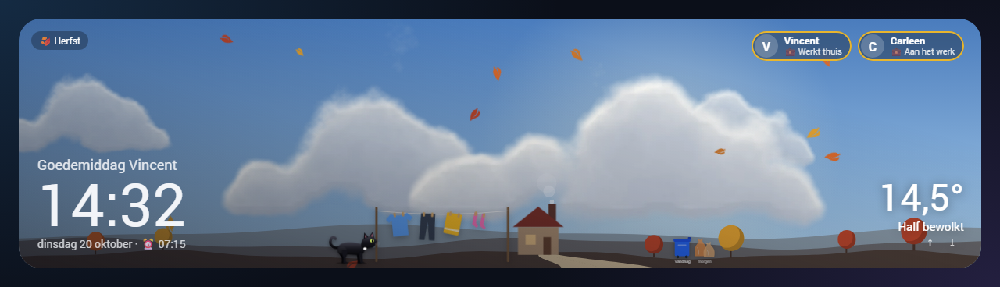
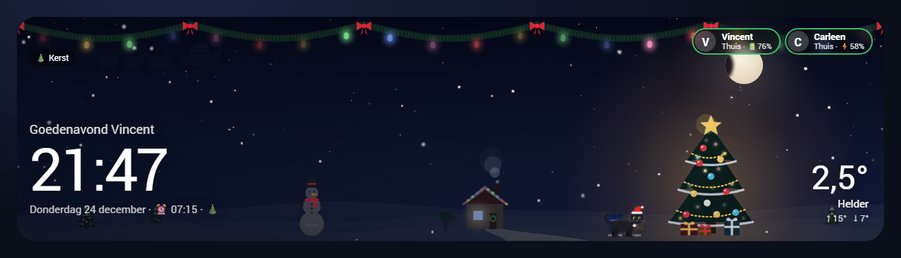
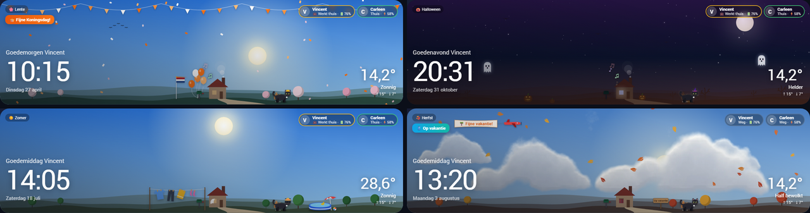
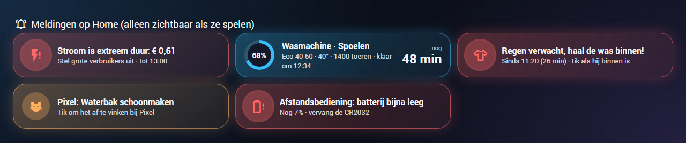
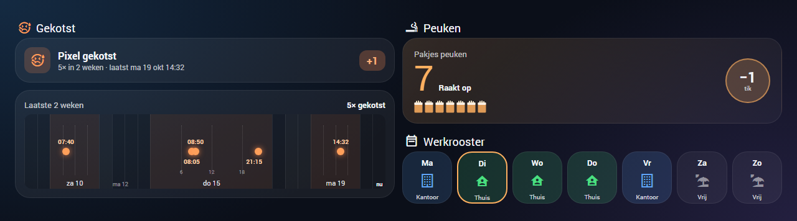
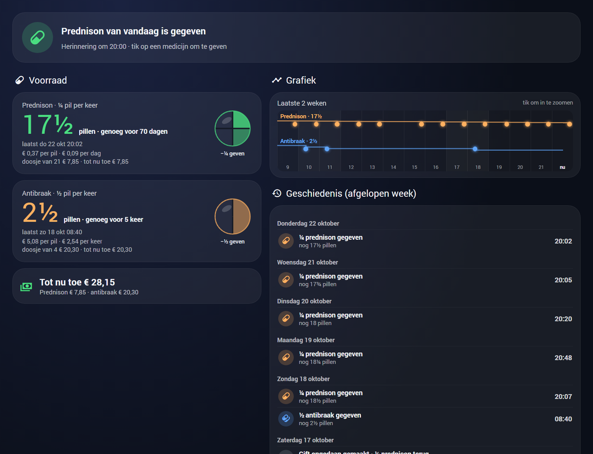
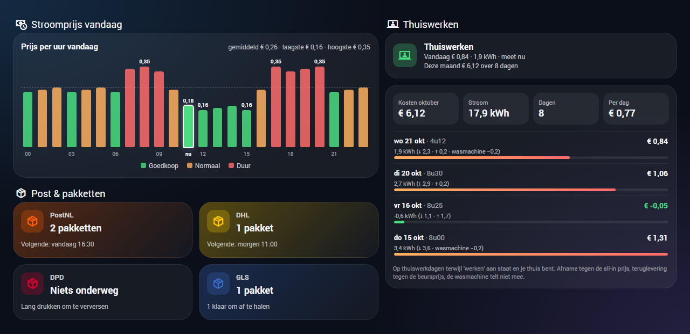

# Home Automation NetDaemon

A fully personal smart home, built with **NetDaemon 26** on **.NET 10** on top of Home Assistant, together with a
hand-made Home Assistant dashboard that brings it all together.

## 📋 Overview

This project implements the automation logic of the house as C# apps on NetDaemon, and ships the Lovelace dashboard
that shows it. The apps react to sensors, schedules and people, and manage lighting, presence, the cat, laundry,
energy, parcels, notifications and more.

**Project Type:** Personal NetDaemon-based Home Automation System

Highlights:
- **Smart lighting** — motion, time of day, circadian colour temperature and per-room scenes
- **Presence and routines** — per-person presence, work schedules (office, home or off per day), sleep and wake-up
- **The cat, Pixel** — automatic feeding, litter box and fountain monitoring, his medication (with reminders, stock and
  costs) and a log of when he threw up
- **Energy** — dynamic prices, warnings for extreme prices, the cost of working from home, and power estimates for
  devices that only report kWh
- **Household** — laundry advice and monitoring, garbage pickup, parcels from PostNL, DHL, DPD and GLS
- **Tasks and agenda** — a to-do list per person plus a shared one, tasks with a place (a WhatsApp message when you walk
  into that zone) and one agenda that shows appointments and open tasks together
- **The car** — our Peugeot 2008: status, fuel and service on the dashboard, reminders (low fuel, service, not locked,
  a door left open) and security (it drives off while we are home, a door opens while we sleep)
- **The tablet** — the living room tablet (Fully Kiosk) wakes up on motion, wake-up times, coming home and important
  alerts, and goes off when the TV turns on or everyone sleeps
- **Notifications** — Discord, the mobile app, text-to-speech and a WhatsApp assistant (text and voice notes)
- **Self-maintaining** — creates its own Home Assistant helpers, reloads failing integrations and auto-updates; sends a
  heartbeat every minute so Home Assistant notices when NetDaemon itself is down, and a second one over MQTT to notice when
  its sensors stop updating (for example after a refused login); the dashboard then shows an alert

## 🖥️ Dashboard

The dashboard lives in [`dashboard/`](dashboard) as a YAML-mode Lovelace dashboard, built mainly with
[button-card](https://github.com/custom-cards/button-card), [Bubble Card](https://github.com/Clooos/Bubble-Card),
[Navbar Card](https://github.com/joseluis9595/lovelace-navbar-card) and
[Calendar & Tasks Card](https://github.com/korova-sq/calendar-tasks-card) and the "Glass Home" theme. Installation and the
required HACS cards are described in [`dashboard/README.md`](dashboard/README.md).

> The screenshots below are rendered from the real dashboard templates with made-up data.

### Weather card

The heart of the Home page: a live sky (sun and moon at their real position, generated clouds, rain, snow, fog and
storms, KNMI weather warnings, and planes overhead from Flightradar24) over a landscape that changes with the season.
Our house on the hill tells what is going on at home:

- **Who is home** — smoke from the chimney and a lit window; on warm days an open window with a waving curtain instead
- **Inside** — music notes rising from the roof when a speaker plays, blue TV light behind the window
- **Outside** — the laundry on the line (swaying in the wind), garbage bags or the paper bin at the curb, a paddling
  pool with a rubber duck on hot sunny days
- **Post** — the letterbox fills up when there is mail, and today's parcels stand stacked at the door
- **On vacation** — curtains closed, a sign by the path and a banner plane; the light is on when the house sitter is there
- **Pixel** — he wanders around and, ten minutes before his food, sits at the front door wagging his tail, wearing a
  hat that fits the day: a Santa hat, a mitre, bunny ears, a crown on King's Day, a party hat on birthdays, a rain hat,
  a woolly hat when it freezes or a straw hat with sunglasses when it's hot

Holidays and our own days get their own decorations: Sinterklaas, Christmas, New Year, Easter, Halloween, King's Day,
Valentine's Day, Liberation Day, Remembrance Day (the flag at half-mast), our birthdays (also Pixel's) and our
anniversary. The birthday dates live in Home Assistant helpers, not in this repository. The pills show who is home,
asleep or working, and kitchen timers count down live. For testing, `?test` in the URL shows drop-downs to pick a
theme, a time of day and a scenario (weather, warnings, music and TV, post, vacation, ...).







### Alerts on Home

Everything that needs attention right now gets an eye-catching card on Home, and disappears again when it no longer
matters: extreme electricity prices, the running washing machine with its phase and time left, laundry outside when
rain is coming, Pixel's medicine when it is due or running out, problems with his things and batteries below 10%.



### Home: labels, agenda, tasks and the car

- **Labels** next to the weather card show what is on its way (parcels, letters, open tasks). A tap opens a pop-up
  with the details: the history of every parcel as a timeline, or the three task lists.
- **Agenda and tasks** — today's and tomorrow's appointments of our calendars and the open tasks of the three lists in
  one timeline. The colour tells whose it is: blue is Vincent, pink is Carleen, purple is both of us. Tasks can be
  ticked off and added right there.
- **Tasks with a place** — the tile "Taak met plek" adds a task to a list, with a zone and, if wanted, a WhatsApp
  message when that person walks into the zone ("Boodschappen AH: milk, bread").
- **The car** — a card with the status (locked and closed, or what is open), the alarm, fuel and range, where it is and
  when the service is due, with buttons to lock, unlock and flash the lights. While the car is at home, it stands on the
  driveway next to the house in the weather card.
- **NetDaemon alert** — when NetDaemon stops sending its heartbeat, a red alert appears at the top; a tap restarts the
  add-on.

> The screenshots in this section were made before these additions.

### Pixel and the personal pages

A two-week timeline of when Pixel threw up, where days with more moments get more room so the times stay readable.
Vincent and Carleen each have a private page with their own work schedule (tap a day for off, home or office) and,
for Vincent, the stock of cigarette packs.



### Pixel's medication

Pixel gets a quarter of a prednison pill every evening and half an antibraak pill when needed. A tap on the pill gives
a dose; the circle shows how much of the started pill is left, with the piece you give next softly blinking. From the
reminder time Home shows a card until it is given, and an hour later both phones get a notification with a "Given"
button (the next morning a "forgotten" one). The stock comes with the price per pill, per dose and per box and what it
cost so far; a two-week chart and the full history (kept forever, with undo as a correction line) complete the page.



### Energy, parcels and working from home

Hourly prices for today, parcels per carrier, and per day how much electricity working from home used and cost —
imports at the all-in price, feed-in at the market price, without the washing machine.



## 🚀 Quick Start

```bash
# Build the project
dotnet build

# Run tests
dotnet test

# Deploy (local network)
./automation/Scripts/Build\ and\ deploy\ over\ LAN.ps1
```

## 📚 Documentation

> **Note**: This documentation was generated and structured with assistance from **Claude (Anthropic)**.

### Core Documentation
- **[Technical Specifications](docs/technical-specifications.md)** - C# version, NetDaemon version, and architecture details
- **[Integrations & Connections](docs/integrations.md)** - Discord, Home Assistant, external services
- **[Logging & Monitoring](docs/logging-and-monitoring.md)** - Discord logging, error handling, debugging
- **[Configuration](docs/configuration.md)** - App configuration, settings and customizations
- **[Testing Framework](docs/testing.md)** - Details on Rx testing, AppTestContext, and time manipulation
- **[Product List](docs/products-and-hardware.md)** - Smart home devices and integrations used

### Apps

#### 🏠 General Apps
- **[Alarm System](docs/apps/alarm.md)** - Security monitoring, high temperature and energy price warnings
- **[Auto Update](docs/apps/auto-update.md)** - Monthly Home Assistant updates with notifications
- **[Away Manager](docs/apps/away-manager.md)** - Away and welcome-home state machine
- **[Battery Monitoring](docs/apps/battery-monitoring.md)** - Low battery notifications for all devices
- **[Cat Care](docs/apps/cat.md)** - Automatic feeding, litter box and fountain monitoring
- **Car Monitor** - Peugeot 2008: reminders (low fuel, service, not locked, a door left open) and security
- **Cat Vomit Tracker** - Remembers when Pixel threw up and publishes the last two weeks for the dashboard
- **[CoC Monitoring](docs/apps/coc-monitoring.md)** - Clash of Clans activity monitoring via social media
- **[Fun App](docs/apps/fun.md)** - Entertainment and special occasion automations
- **[Google Assistant Translate](docs/apps/google-assistant-translate.md)** - Voice command translation and automation
- **Helper Manager** - Creates the missing Home Assistant helpers (input_boolean, input_select, counter, ...) from code
- **[Holiday Manager](docs/apps/holiday-manager.md)** - Days off from the calendar and the matching alarm reminders
- **Home Work Energy Tracker** - Electricity use and costs per day while working from home
- **[House State Manager](docs/apps/house-state-manager.md)** - House states (morning/day/evening/night) and per-person working hours
- **Integration Monitor** - Detects failing integrations and reloads them
- **Laundry** - Washing machine monitoring and advice on drying the laundry outside
- **[NetDaemon System](docs/apps/netdaemon-system.md)** - System monitoring and lifecycle management
- **Parcel Notifications** - Notifications for new parcels, status changes and PostNL letters
- **[PC Manager](docs/apps/pc-manager.md)** - PC-related automations and device control
- **Pixel Medication** - Pixel's doses, stock, prices and reminders, with the full history kept forever
- **Power Estimator** - Estimated power for devices that only report an energy meter (such as the washing machine)
- **NetDaemon Heartbeat** - Beats every minute, so Home Assistant and the dashboard notice when NetDaemon is down
- **Presence Manager** - Per-person presence and the shared away state
- **Presence Simulation** - Makes the house look lived-in while on vacation
- **[Reset App](docs/apps/reset.md)** - System reset and restoration capabilities
- **[Save In State](docs/apps/save-in-state.md)** - Device state management and restoration
- **[Sleep Manager](docs/apps/sleep-manager.md)** - Sleep routines, roller blind and wake-up
- **Todo Zone Reminders** - Tasks with a place: a WhatsApp message with what is left to do when someone walks into the zone
- **[Vacuum](docs/apps/vacuum.md)** - Robot vacuum automation and room-specific cleaning
- **WhatsApp Assistant** - Answers text and voice messages from Vincent and Carleen through the Home Assistant assistant

#### 🚪 Room-specific Apps
- **[Bathroom](docs/apps/bathroom-lights.md)** - Motion detection, shower mode, music automation
- **[Bedroom](docs/apps/bedroom-lights.md)** - Light automation for the bedroom
- **[Hall](docs/apps/hall-lights.md)** - Motion detection and light brightness in the hallway
- **Kitchen Music** - Music in the kitchen on motion when nobody is working
- **[Living Room](docs/apps/living-room.md)** - Lighting, TV automation and gaming mode
- **Tablet Screen** - Wakes the living room tablet (Fully Kiosk) on motion, wake-up times, coming home and alerts, and turns it off

## 🛠️ Development

```bash
# Code generation for NetDaemon (after adding entities or helpers in Home Assistant)
dotnet tool run nd-codegen

# Local build and deployment
dotnet publish -c Release -o ./Release
```

New helpers are added in `automation/Configuration/HelperDefinitions.cs`: the Helper Manager creates them in Home
Assistant on the next start, after which code generation makes them available as typed entities. Helpers keep their
value over restarts, so they do not get an `initial` value (Home Assistant puts a helper with `initial` back on it at
every restart); a start value is set once, when the helper is created.

Code inspections run with the shared Rider settings in `HomeAutomation.sln.DotSettings`.

## 🏗️ Project Structure

```
automation/
├── apps/                  # All automation apps
│   ├── General/           # General automations
│   └── Rooms/             # Room-specific automations
├── Configuration/         # Configuration classes and the helper definitions
├── Core/                  # Core services (entity manager, assistant clients)
├── CustomLogger/          # Logging, including Discord
├── Enum/                  # Enumerations
├── Extensions/            # Extension methods (Dutch-time scheduling, ...)
├── Helpers/               # Utility classes
├── Interfaces/            # Service interfaces
├── Models/                # Data models
└── Repository/            # Data persistence

dashboard/                 # Home Assistant dashboard (YAML), theme and templates
TestAutomation/            # Unit tests
TestIntegration/           # Integration tests
docs/                      # Documentation and dashboard screenshots
```

## 📄 License

This project is licensed under the MIT License - see the [LICENSE](LICENSE) file for details.

## 🆘 Support

For questions or support:
- Open a GitHub Issue
- Join the [NetDaemon Discord server](https://discord.gg/K3xwfcX)
